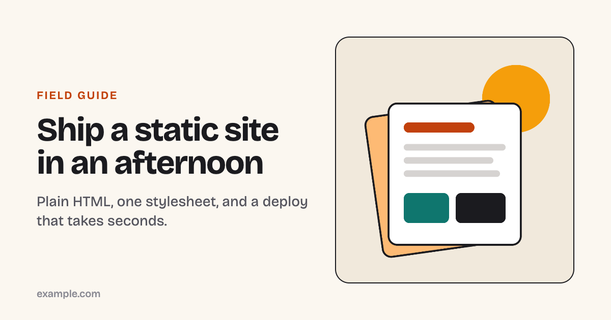

# @bydtech/og-cards

Draw Open Graph link-preview images with real Chrome: your fonts, your CSS, and live screenshots of your own pages.

[](https://www.npmjs.com/package/@bydtech/og-cards)
[](https://github.com/BYDTechSolutions/og-cards/actions/workflows/ci.yml)
[](LICENSE)



## Why it exists

A shared link is often the first thing anyone sees of a site, and most sites hand every page the same generic card. The usual generators render HTML with [satori](https://github.com/vercel/satori), which cannot read WOFF2 fonts, draws a variable font at its default instance only, and supports a subset of CSS (no grid, no container queries), so a card rarely looks like the site it links to.

`og-cards` renders each card in headless Chrome, so anything Chrome can draw works. It can also screenshot an element from your live site, such as the hero illustration, and put it on the card, so the preview shows the same picture the page does. It works with any site: Next.js, Astro, a static folder, or anything else that serves HTML.

## Install

```sh
npm install --save-dev @bydtech/og-cards
```

It drives Chrome through [`playwright-core`](https://www.npmjs.com/package/playwright-core), which downloads no browser. It uses Google Chrome if it is installed. Otherwise, install Playwright's Chromium once:

```sh
npx playwright install chromium
```

## Quick start

Create `og-cards.config.mjs` at your project root:

```js
import { defineConfig, escapeHtml } from '@bydtech/og-cards';

export default defineConfig({
  out: 'public/og',
  cards: [
    { name: 'home', title: 'Hello, world', sub: 'A card drawn by Chrome.' },
    { name: 'about', title: 'About us', sub: 'Who we are and what we make.' },
  ],
  template: (card, { width, height }) => `<!doctype html>
    <html><head><meta charset="utf-8"><style>
      body { margin: 0; width: ${width}px; height: ${height}px; padding: 80px; box-sizing: border-box;
             background: #0e1230; color: white; font-family: system-ui, sans-serif; }
      h1 { font-size: 72px; margin: 0 0 24px; }
      p { font-size: 32px; opacity: .8; }
    </style></head>
    <body><h1>${escapeHtml(card.title)}</h1><p>${escapeHtml(card.sub)}</p></body></html>`,
});
```

Then run:

```sh
npx og-cards
```

```
public/og/home.png
public/og/about.png
```

Point each page's `og:image` at its file, e.g. `<meta property="og:image" content="https://example.com/og/home.png">`.

The [`examples/`](examples) folder has two complete setups: [`basic`](examples/basic) (a template function, an inlined WOFF2 font, and a capture) and [`html-template`](examples/html-template) (an HTML file with placeholders, a stylesheet and an SVG next to it).

## CLI

```
og-cards [options]

  -c, --config <file>        config file (default: og-cards.config.mjs or .js in the current directory)
      --only <names>         comma-separated card names to draw
  -o, --out <dir>            output directory (overrides the config's "out")
      --concurrency <n>      cards drawn at once (default: 4)
      --executable-path <p>  Chrome/Chromium binary (or set OG_CARDS_CHROME)
  -h, --help                 show help
  -v, --version              show the version
```

It prints the path of each file it writes to stdout, and warnings and errors to stderr.

| Exit code | Meaning |
|---|---|
| `0` | Every card was written (warnings may have been printed). |
| `1` | At least one card failed. The others were still written. |
| `2` | Bad usage, an invalid or missing config, an unknown `--only` name, or no browser found. |

## API

```js
import { loadConfig, generate } from '@bydtech/og-cards';

const { config } = await loadConfig();           // finds og-cards.config.mjs in process.cwd()
const result = await generate(config, { only: ['home'] });
for (const card of result.results) console.log(card.name, card.file, card.warnings, card.error);
```

| Export | What it does |
|---|---|
| `defineConfig(config)` | Returns `config` unchanged; gives editors the types. |
| `generate(config, options?)` | Draws the cards and writes the images. Returns `{ results, written, failed }`. A failing card does not stop the others. |
| `loadConfig(file?, cwd?)` | Finds, imports and validates a config file. Its default export may be the config or a function (sync or async) that returns it. Returns `{ file, config }`. |
| `resolveConfig(config, dir?)` | Validates a config object and fills in defaults, resolving relative paths against `dir`. |
| `launchBrowser({ executablePath? })` | Launches headless Chrome in the order described under [How it works](#how-it-works). Returns `{ browser, source }`. |
| `escapeHtml(value)` | Escapes `& < > " '`. `null` and `undefined` become `''`. |
| `dataUri(file, type?)` | Reads a file into a base64 `data:` URI. The media type comes from the extension (WOFF2, WOFF, TTF, OTF, SVG, PNG, JPEG, WebP, AVIF, GIF, CSS and more) or from `type`. |
| `fontFace({ family, file, weight?, style? })` | An `@font-face` rule with the font inlined. Use a range such as `'200 800'` as `weight` for a variable font. |
| `renderTemplate(source, data)` | The placeholder engine used for HTML template files. |
| `ConfigError`, `CaptureError`, `BrowserNotFoundError` | Error classes, so you can tell the failures apart. |

`generate` options:

| Option | Default | Description |
|---|---|---|
| `only` | all cards | Card names to draw. An unknown name throws `ConfigError`. |
| `out` | config `out` | Output directory, relative to `cwd`. |
| `concurrency` | `4` | Cards drawn at once. |
| `executablePath` | | Chrome/Chromium binary. |
| `browser` | | A Playwright `Browser` you launched; it is reused and left open. |
| `cwd` | `process.cwd()` | Base for relative paths when `config` is a plain object. |
| `onResult` | | Called with each card's result as it finishes. |

A relative string path given to `dataUri` or `fontFace` resolves from the current working directory. To resolve it from the config file, pass `new URL('./fonts/x.woff2', import.meta.url)`.

## Configuration

| Option | Default | Description |
|---|---|---|
| `cards` | (required) | The cards to draw: `[{ name, ...fields, capture? }]`. `name` is the file name without extension; it may contain `/` for subfolders. Every other field is yours, for the template. |
| `template` | (required) | A function `(card, ctx) => html` (may be async), or the path of an HTML file. |
| `out` | `'og'` | Output directory, relative to the config file. |
| `width` | `1200` | Card width in CSS pixels. |
| `height` | `630` | Card height in CSS pixels. |
| `deviceScaleFactor` | `1` | Pixel density. `2` turns a 1200×630 card into a 2400×1260 file. |
| `format` | `'png'` | `'png'` or `'jpeg'`. JPEG files get the `.jpg` extension. |
| `quality` | `90` | JPEG quality, 0–100. Ignored for PNG. |
| `baseUrl` | | Base for relative `capture.url` values, e.g. `'http://localhost:3000'`. Must be `http:`, `https:` or `file:`. |
| `overflowSelector` | `'body'` | Elements to check for overflowing text (see below). `false` turns the check off. |

### Templates

A **template function** receives the card and a context:

| `ctx` field | Description |
|---|---|
| `width`, `height` | The card size in CSS pixels. |
| `image` | The captured element as a PNG `data:` URI, when the card has a `capture`. |
| `imagePosition` | The capture's `position`, or `'center'`, ready for `background-position` or `object-position`. |
| `dir` | The directory relative URLs resolve against (the config file's). |

It returns a complete HTML document. Escape your fields with `escapeHtml`.

An **HTML template file** uses placeholders. `{{field}}` inserts the HTML-escaped value and `{{{field}}}` the raw value. Dotted paths such as `{{author.name}}` reach into objects, and a missing value renders as an empty string. The placeholders available are the card's own fields plus `width`, `height`, `image` and `imagePosition`.

In both kinds, relative URLs (`card.css`, `fonts/display.woff2`, `logo.svg`) load from the template's directory: the HTML file's folder, or the config file's folder for a template function. Requests that would leave that directory are refused, and a missing file produces a warning. Fonts and images can also be inlined with `fontFace` and `dataUri`.

### Captures

```js
{ name: 'home', title: '…', capture: { url: '/', selector: '.hero-art', width: 1280, position: 'top' } }
```

| `capture` field | Default | Description |
|---|---|---|
| `url` | (required) | Page to open; relative URLs resolve against `baseUrl`. `file:` URLs work too. |
| `selector` | (required) | CSS selector of the element to screenshot; the first match is used. |
| `width` | `1280` | Viewport width of the captured page. Use a narrow width to capture a responsive layout's mobile arrangement. |
| `height` | `800` | Viewport height. |
| `position` | `'center'` | Passed to the template as `imagePosition`. |
| `deviceScaleFactor` | `2` | Screenshot density, so the image stays sharp when the card scales it. |
| `reducedMotion` | `true` | Open the page with `prefers-reduced-motion: reduce`, so animations are captured at rest. |
| `timeout` | `5000` | Milliseconds to wait for the selector to become visible after the page has loaded. |

The page must be running when you generate: start your dev server or a preview of your build first.

## How it works

1. **Browser.** One headless browser is launched per run, trying in order: `--executable-path` or the `OG_CARDS_CHROME` environment variable; the installed Google Chrome (`channel: 'chrome'`); Playwright's own Chromium. An explicit path that does not exist is an error rather than a fallback. If nothing launches, the error says how to install a browser. `playwright-core` is the only runtime dependency: it is what talks to Chrome, and it does not download a browser on install.
2. **Captures.** For each distinct `url` + `selector` (and viewport), a page is opened, the tool waits for the network to go idle and for `document.fonts.ready`, then screenshots the first matching element with CSS animations stopped. Two cards with the same capture share one screenshot. If the selector matches nothing, the card fails with `selector ".x" matched nothing on <url>`. An HTTP error status also fails the card.
3. **Cards.** Up to `concurrency` pages render cards, each page reused for card after card. The HTML is served from a private origin (`https://og-cards.invalid`, answered entirely inside the browser) so relative URLs work. Before each screenshot the tool waits for the page's `load` event, `document.fonts.ready` and every `` to decode, so text is never drawn in a fallback font and images are never blank.
4. **Overflow check.** After layout, each element matching `overflowSelector` whose content is larger than its box (`scrollHeight > clientHeight` or `scrollWidth > clientWidth`) produces a warning, as does a document larger than the card. Warnings do not fail the run.

Limits, plainly:

- It needs a Chrome or Chromium binary, and every run starts a browser, so it is a build step, not something to run per request.
- The images are files. Re-run it when a card's text or captured picture changes.
- A capture is only as current as the page it opens. Pages that keep a network connection busy (polling, long requests) may never reach network idle and will hit Playwright's 30-second navigation timeout.
- The overflow check measures boxes. It cannot tell intentional clipping (`text-overflow: ellipsis`, line clamping) from a mistake; narrow `overflowSelector` or set it to `false` for those cards.
- Config files are ES modules. Use `.mjs`, or `.js` in a package with `"type": "module"`. TypeScript config files are not loaded.

## Contributing

Issues and pull requests are welcome. See [CONTRIBUTING.md](CONTRIBUTING.md). Security reports: [SECURITY.md](SECURITY.md).

## License

[MIT](LICENSE). The font in `examples/basic/fonts` is Bricolage Grotesque, under the [SIL Open Font License 1.1](examples/basic/fonts/OFL.txt).

---

Maintained by [BYD Tech](https://bydtech.in), a software studio that builds MVPs, AI agents, and web & mobile apps.
